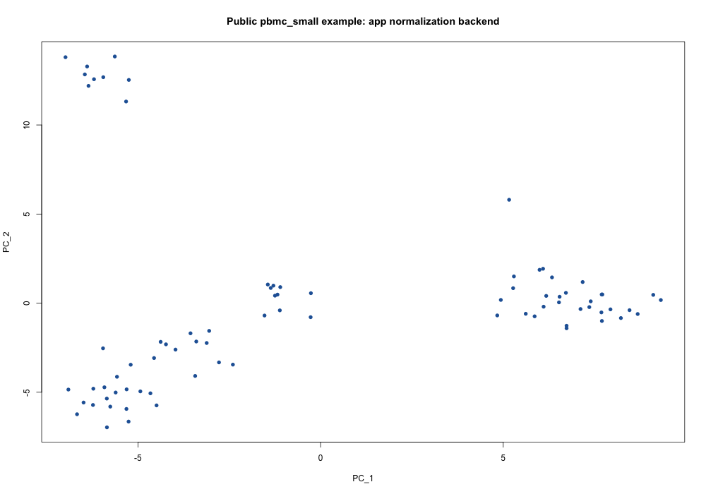

# Public single-cell example

The example uses `pbmc_small`, the public 230-gene, 80-cell example distributed with SeuratObject. See its [upstream documentation](https://satijalab.github.io/seurat-object/reference/pbmc_small.html).

After preparing the app's managed Seurat environment, run from the repository root:

```sh
Rscript --vanilla -e '.libPaths(c("package_libraries/seurat_v4", "package_libraries/core", .libPaths())); source("examples/public_pbmc.R")' example-output
```

For Seurat 5, replace `seurat_v4` with `seurat_v5`. These library paths must already exist; the example does not install packages or silently select a runtime. In an R console with the intended environment already active, use `source("examples/public_pbmc.R")`.

The script creates a new object from the supplied raw counts, then calls the app's normalization backend with `LogNormalize`. It checks that all 80 cells, all 230 genes and the raw counts remain unchanged, and that PCA returns 50 finite principal components. It performs no cell filtering, integration, clustering or cell-type annotation.

Expected final output:

```text
PASS: 230 genes, 80 cells, 50 finite principal components; counts and cells unchanged.
```

A numerical-method warning about computing a large fraction of singular values is expected for this tiny dataset. It does not invalidate the finite-value and count-preservation checks. This example is not a benchmark for integration, rare-cell recovery, annotation or biological accuracy.

The optional output directory receives a Seurat RDS object and a PCA PNG. Use the Workspace page to review the RDS import; the raw-data sidebar does not accept RDS files. Generated files stay local and are ignored by Git.


